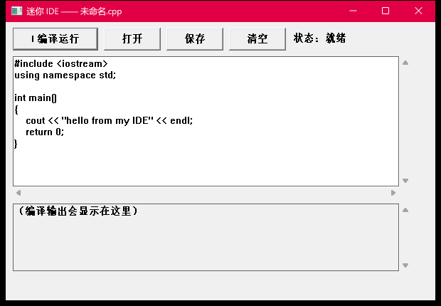

# 迷你 IDE · C++ 实战练习

> 学编程不是为了学编程，是为了**做能用的东西**。
> 这个仓库是完整的实践记录：从一个 `cout << "hello"` 到一个**能写代码、能编译、能运行**的小型 IDE。



---

## 这是什么

一个用 **C++ + Win32 API** 从零手写的迷你 IDE（Windows 桌面程序）：

| 功能 | 说明 |
|---|---|
| 代码编辑区 | 多行文本框，可滚动 |
| ▶ 编译运行 | 调 `g++` 编译当前代码，编译成功自动运行生成的 exe |
| 打开 / 保存 | 系统文件对话框（`GetOpenFileNameW` / `GetSaveFileNameW`） |
| 错误显示 | 把 g++ 的报错原文显示在下方输出区 |
| 快捷键 | `Ctrl+S` 保存、`Ctrl+O` 打开 |

**★ 注意：VS 自己也不写编译器——它调用 MSVC。这个 IDE 同样调用现成的 `g++`，自己做的是编辑、编译调度和错误展示。**

---

## 其他成果

| 程序 | 说明 | 截图 |
|---|---|---|
| **打车费计算器** | 4 个输入框 + 计算按钮，里程/等待/行李费分项计算 | [截图](docs/screenshot-taxi.png) |
| **迷你词法分析器** | 把 `12 + 3 * 4` 切成 token 序列（编译器第一步） | 见 `X1_迷你编译器/` |

---

## 目录结构

```
cpp学习/
├── X2_迷你IDE/           ★ 迷你 IDE 本体（ide.cpp）
├── X1_迷你编译器/         词法分析（tokenizer）
├── W2_打车费界面/         打车费 GUI（控件 + 消息 + 输入校验）
├── W1_第一个窗口/         Win32 窗口入门
├── L0_3_函数/             函数练习（打车费业务计算）
├── L0_2_循环与数组/        循环、数组、成绩统计
├── L0_1_打车费/           命令行版打车费
├── 模板/                  可复用的窗口程序模板（复制改名就能写新工具）
├── 讲义/                  ★ 全部课程讲义（控件速查、窗口原理、词法分析……）
├── demo/                  教学演示代码
├── build.ps1 / build.bat  一键编译脚本（递归查找 .cpp → 编译 → 运行）
├── 课程表.md              学习路线
└── docs/                  README 用的截图
```

---

## 怎么编译

**环境**：Windows 10/11 + MinGW 的 `g++`（本项目开发时用的是 Dev-C++ 自带的 `g++ 4.9.2`）。

**★ 先改路径**：`build.ps1` 里的 `$GXX` 和 `X2_迷你IDE/ide.cpp` 里的 `g++` 路径是本机路径，换成你自己的。

### 方式一：双击

```
双击 build.bat → 编译"最近修改的 .cpp"并运行
把某个 .cpp 拖到 build.bat 上 → 只编译那个
```

### 方式二：命令行

```powershell
Set-ExecutionPolicy -Scope CurrentUser RemoteSigned   # 首次放行脚本
.\build.ps1 ide            # 编译 X2_迷你IDE/ide.cpp 并运行
.\build.ps1 ide -NoRun     # 只编译不运行
```

**★ 本机踩过的坑**：`g++` 写不进系统 `%TEMP%` 时，编译前要把 `TMP/TEMP` 指到一个可写目录（`build.ps1` 和 IDE 里都做了处理）。

---

## 学习路线

见 [课程表.md](课程表.md)。当前进度：

```
L0-1 变量与类型        ✅
L0-2 循环与数组        ✅
L0-3 函数              ✅
W1   窗口原理          ✅
W1.5 键盘消息与多行绘制  ✅
W2   控件与消息        ✅
W2.5 输入校验          ✅
X1   词法分析（编译器第一步）  🟡 进行中
X2   迷你 IDE          ✅ 可用（本仓库主角）
```

---

## 讲义

所有课程都落盘在 [`讲义/`](讲义/) 目录，包括：

- [术语表](讲义/术语表.md) —— 所有术语的人话解释
- [控件速查](讲义/控件速查.md) —— Win32 控件类名/样式/消息一览
- [窗口原理](讲义/W1_窗口原理.md) —— 句柄、消息循环、WndProc
- [词法分析](讲义/X1-1_词法分析.md) —— 编译器的第一步
- [迷你 IDE](讲义/X2-1_迷你IDE.md) —— 本文这个 IDE 的实现原理

---

## License

[MIT](LICENSE)
